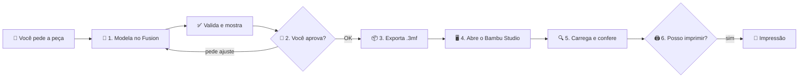

<div align="center">

# 🖨️ generate-bambu

**Peça uma peça. O Claude modela no Fusion, valida, exporta o `.3mf` multicor e deixa pronto no Bambu Studio.**

*Uma skill do Claude que leva uma ideia da conversa até a mesa da impressora, com você aprovando cada passo importante.*

<br>


[](https://github.com/Grolla05/Generate-bambu/actions/workflows/ci.yml)


[Como funciona](#-como-funciona) •
[Demonstração](#-demonstração) •
[Instalação](#-instalação) •
[Como usar](#-como-usar) •
[Decisões de design](#-decisões-de-design) •
[Limitações](#-limitações)

</div>

---

## 💡 Sobre

Este projeto nasceu de um problema simples: **comprei uma impressora 3D sem saber modelar nos mínimos detalhes**. Eu tinha só uma noção básica, e o gargalo nunca foi a máquina, foi o conhecimento de modelagem.

A solução foi transformar o processo em uma **skill do Claude**: uma sequência fixa de seis passos que vai do pedido em linguagem natural até o projeto fatiado no Bambu Studio. O Claude cuida da parte repetitiva e técnica. As decisões que importam continuam sendo suas: **você aprova a forma antes de exportar e confirma antes de imprimir**.

> [!NOTE]
> A skill é focada em **geometria construída**: placas, letreiros, chaveiros, lembrancinhas, ímãs, vasos, potes, caixas com tampa, suportes, engrenagens e peças com rosca ou encaixe. Rostos, corpos e animais realistas ficam fora do método (veja [Limitações](#-limitações)).

---

## ⚙️ Como funciona



| # | Passo | O que acontece |
|:-:|---|---|
| **1** | 🧩 **Modelar, validar e mostrar** | O Claude cria um design **paramétrico** no Fusion, via script. Cada cor é um corpo separado (`slotN_descricao`). Roda uma validação automática e deixa a peça aberta no Fusion para você girar e inspecionar. |
| **2** | 👤 **Esperar o OK** | Parada obrigatória. Se pedir ajuste, o Claude muda os parâmetros no **mesmo documento**, valida de novo e salva uma nova versão. |
| **3** | 📦 **Exportar o `.3mf`** | Só depois do OK. Um único `.3mf` com **um objeto por slot do AMS**, camada de 0,12 mm. Sem STL, sem ZIP, sem pasta de arquivos soltos. |
| **4** | 🖥️ **Abrir o Bambu Studio** | O Claude abre o programa e trata janelas de update, login e seleção de impressora. |
| **5** | 🔍 **Carregar e conferir** | Abre o projeto, confere cores, **dimensões** (contra o que o Fusion mostrou) e filamentos, e fatia. |
| **6** | 🖨️ **Perguntar antes de imprimir** | Mostra o **tempo estimado** e os **gramas por filamento**, e só manda imprimir com a sua resposta. |

### ✅ O que a validação garante (passo 1)

- Todo corpo é sólido e tem o prefixo `slotN_`
- Alturas em **múltiplos da camada** (0,12 mm)
- Peça inteira dentro de **250 × 250 × 250 mm** (Bambu Lab A1)
- No máximo **4 slots** de cor (AMS Lite)
- **Nenhuma interferência** entre corpos e nenhuma cor padrão do Fusion
- Espessuras mínimas e balanços conferidos contra as regras de FDM da A1

---

## 🎬 Demonstração

> [!TIP]
> Substitua as imagens abaixo pelas suas capturas. Basta salvar os arquivos em `docs/images/` com os nomes indicados e o README passa a exibi-los.

### Do pedido à peça

<div align="center">


<sub><i>Fluxo completo, do pedido ao slice (GIF)</i></sub>

</div>

### Passo a passo

<table>
  <tr>
    <td align="center" width="50%">
      <br>
      <b>1. O pedido</b><br>
      <sub>Linguagem natural, sem precisar saber modelar</sub>
    </td>
    <td align="center" width="50%">
      <br>
      <b>2. Modelagem no Fusion</b><br>
      <sub>Design paramétrico, um corpo por cor</sub>
    </td>
  </tr>
  <tr>
    <td align="center" colspan="2">
      <br>
      <b>3. Bambu Studio</b><br>
      <sub>Cores por slot e dimensões conferidas</sub>
    </td>
  </tr>
</table>

### Resultado

<div align="center">


<sub><i>A peça final impressa na Bambu Lab A1 com AMS Lite</i></sub>

</div>

---

## 📋 Requisitos

| Requisito | Detalhe |
|---|---|
| 🤖 **Claude** | [Claude Code](https://code.claude.com/docs/en/overview) ou o app desktop do Claude, com suporte a plugins |
| 🧩 **Autodesk Fusion** | Instalado, com o **servidor MCP do Fusion** conectado ao Claude (a skill modela via `fusion_mcp_execute`) |
| 🖨️ **Impressora** | Bambu Lab **A1** com **AMS Lite** (até 4 cores) |
| 🖥️ **Bambu Studio** | Instalado, com a interface em **inglês** |
| 🪟 **Sistema** | Windows (os caminhos e o fluxo do Bambu Studio foram testados nele) |
| 🖱️ **Controle do computador** | Os passos 4 a 6 operam o Bambu Studio por captura de tela e clique, então exigem o app desktop do Claude com permissão de uso do computador |

> [!IMPORTANT]
> Os passos 1 a 3 (modelar, validar e exportar) só dependem do Fusion. Se você não tiver o controle do computador habilitado, a skill ainda gera o `.3mf`, e você abre o arquivo manualmente no Bambu Studio.

---

## 🚀 Instalação

Este repositório é, ao mesmo tempo, um **plugin** e um **marketplace** do Claude. Escolha o método que combina com o seu uso.

### Opção 1: pelo terminal (Claude Code)

```bash
# 1. Registre este repositório como marketplace
claude plugin marketplace add Grolla05/Generate-bambu

# 2. Instale o plugin
claude plugin install generate-bambu@grolla05-plugins
```

### Opção 2: dentro de uma sessão do Claude Code

```text
/plugin marketplace add Grolla05/Generate-bambu
/plugin install generate-bambu@grolla05-plugins
```

Depois da instalação, rode `/reload-plugins` ou abra uma nova sessão.

### Opção 3: app desktop do Claude

O mesmo formato de plugin também funciona no app desktop. Adicione `Grolla05/Generate-bambu` como marketplace pela tela de plugins e instale o `generate-bambu`. As instruções atualizadas estão em [Plugins no claude.ai e no Cowork](https://claude.com/docs/plugins/overview).

### Opção 4: instalação manual (só a skill)

Se preferir não usar marketplace, copie a pasta da skill para o diretório de skills do Claude:

```powershell
# Windows (PowerShell)
Copy-Item -Recurse .\plugins\generate-bambu\skills\generate-bambu "$env:USERPROFILE\.claude\skills\generate-bambu"
```

> [!NOTE]
> Instalada como skill avulsa, ela é chamada por `/generate-bambu`. Instalada como plugin, o nome ganha o prefixo do plugin: `/generate-bambu:generate-bambu`.

### ✔️ Conferindo a instalação

```bash
claude plugin list                    # deve listar generate-bambu@grolla05-plugins como enabled
claude plugin details generate-bambu  # deve mostrar a skill generate-bambu
```

### 🔄 Atualizando

```bash
claude plugin marketplace update grolla05-plugins
```

---

## 🕹️ Como usar

Com o plugin instalado e o Fusion aberto, basta pedir. A skill é acionada sozinha em qualquer pedido de criar, desenhar ou modelar uma peça para impressão 3D, ou você pode chamá-la direto:

```text
/generate-bambu:generate-bambu
```

### Exemplos de pedidos

```text
Faz um chaveiro retangular de 60 x 30 mm com o nome "Felipe" em relevo,
base azul e letras brancas.
```

```text
Preciso de um porta-copo redondo de 90 mm com um brasão em relevo de duas cores.
```

```text
Modela um vaso de 80 mm de altura com parede de 2 mm, em uma cor só.
```

```text
Cria uma lembrancinha de 70 x 50 mm com a data "12/10" e uma moldura em dourado.
```

### O que esperar na conversa

1. O Claude confirma o que vai modelar e quantas cores a peça tem.
2. A peça aparece **aberta no Fusion**, com as dimensões finais, a lista de slots (cor, altura, camadas) e os ajustes de camada que foram feitos.
3. Ele pergunta se está aprovado. Você pede ajustes quantas vezes quiser.
4. Com o OK, exporta, abre o Bambu Studio, fatia e mostra **tempo e gramas**.
5. Ele pergunta **"posso mandar imprimir?"** e espera a sua resposta.

---

## 🧠 Decisões de design

| Decisão | Por quê |
|---|---|
| 🧩 **Modelagem só pelo Fusion** | Nada de SVG, malha gerada em código ou OpenSCAD. A peça precisa ser editável de verdade: mudar uma medida é editar um parâmetro, não refazer o desenho. |
| 📐 **Alturas em múltiplos da camada** | O slicer não sabe fazer 0,8 mm numa camada de 0,12 mm. A skill arredonda (0,8 mm vira 0,84 mm) e **avisa cada ajuste**, para você aprovar a peça que realmente vai sair. |
| 🎨 **Um corpo por cor, um objeto por slot** | A cor vai pintada na malha do `.3mf`, e cada slot do AMS vira um objeto. O Bambu Studio já abre o projeto com as cores certas. |
| 🛑 **Duas paradas obrigatórias** | Aprovar a forma (passo 2) e autorizar a impressão (passo 6). Plástico e horas de máquina só são gastos com a sua confirmação. |
| 👁️ **Nada "de memória"** | Se o Claude fala do que está na tela do Fusion ou do Bambu Studio, é porque tirou uma captura e leu. Se não conseguiu, ele diz que não conseguiu. |
| 📏 **Conferência de unidade** | As dimensões no Bambu Studio têm que bater com o Fusion. Uma peça 1000× maior ou menor indica erro de unidade, e a correção é refazer a exportação, nunca escalar no slicer. |
| ⚖️ **Design de terceiros fica de fora** | Personagens, marcas, carros e logos pertencem a outras pessoas. A skill oferece um desenho **original** no lugar. |

---

## 🗂️ Estrutura do repositório

```text
Generate-bambu/
├── .claude-plugin/
│   └── marketplace.json            # catálogo: permite instalar pelo GitHub
├── plugins/
│   └── generate-bambu/
│       ├── .claude-plugin/
│       │   └── plugin.json         # manifesto do plugin
│       └── skills/
│           └── generate-bambu/
│               ├── SKILL.md        # o fluxo de seis passos
│               ├── referencias/
│               │   ├── fusion-api.md   # receitas testadas de script, validação e exportação
│               │   ├── fdm-a1.md       # espessuras, folgas, orientação e balanços da A1
│               │   └── limites.md      # triagem do que cabe (ou não) no método
│               └── helpers/
│                   └── agrupar_3mf.py  # agrupa o 3MF em um objeto por slot
├── .github/
│   └── workflows/
│       └── ci.yml                  # CI: lint (ruff) e testes (pytest, Python 3.10 a 3.13)
├── tests/                          # testes do helper, da documentação e dos manifestos
├── docs/
│   └── images/                     # capturas de tela e GIFs da demonstração
├── pyproject.toml                  # configuração do pytest e do ruff
├── requirements-dev.txt            # pytest e ruff
├── LICENSE
└── README.md
```

---

## ⚙️ Configuração

Alguns caminhos do fluxo são pessoais e podem ser ajustados no `SKILL.md`:

| O quê | Padrão | Observação |
|---|---|---|
| Pasta de saída dos `.3mf` | `D:\Bambu Lab\projeto\` | Troque pela pasta que você usa |
| Projeto no Fusion | `Bubble Studio 3D` | Criado automaticamente se não existir |
| Altura de camada | `0,12 mm` | Parâmetro `camada` no início do design |
| Registro no Obsidian | opcional | A skill pode anotar tempo e gramas de cada peça numa nota de catálogo. Remova a seção *"Depois: registrar no vault"* se não usar. |

---

## ⚠️ Limitações

- **Só geometria construída.** O Fusion faz booleana, fillet, chamfer, shell, rosca e texto. Rosto, corpo e animal realista não cabem no método.
- **Até 4 cores**, pelos 4 slots do AMS Lite. Acima de 2 cores, o custo de purga de filamento sobe.
- **Volume de 250 × 250 × 250 mm**, o limite da Bambu Lab A1.
- **O perfil de impressão não vem no `.3mf`.** A altura de camada de 0,12 mm é ajustada no Bambu Studio a cada projeto.
- **Controle do Bambu Studio por tela é frágil.** Se um clique não faz efeito, a skill para, descreve o que está na tela e pergunta, em vez de repetir às cegas.
- **Licença do Fusion.** Com a licença *Education* (uso não comercial), as peças servem para uso próprio e presentes. Para **vender** o que for impresso, revise a licença do Fusion antes.

---

## 🧪 Testes e CI

A cada push e pull request, o GitHub Actions ([`ci.yml`](.github/workflows/ci.yml)) roda:

| Job | O que valida |
|---|---|
| **Lint** | `ruff check` em todo o código Python |
| **Testes** | `compileall` e `pytest` em Python **3.10, 3.11, 3.12 e 3.13** |

Os testes cobrem o `agrupar_3mf.py` com 3MFs sintéticos (agrupamento por slot, volumes, malhas fechadas, cores, transformações e as recusas de entrada inválida), a sintaxe dos trechos Python da documentação e a consistência dos manifestos do plugin.

Para rodar localmente:

```bash
pip install -r requirements-dev.txt
ruff check .
pytest
```

---

## 🛣️ Roadmap

- [ ] Placa de calibração para medir a folga real de processo da máquina
- [ ] Suporte a outras impressoras da linha Bambu Lab (A1 mini, P1S)
- [ ] Biblioteca de peças-base (chaveiro, porta-copo, placa) como pontos de partida
- [ ] Opção de salvar o perfil de impressão junto com o projeto
- [ ] Versão em inglês da documentação

---

## 🤝 Contribuindo

Ideias, correções e novos tipos de peça são bem-vindos. Abra uma *issue* descrevendo o caso ou envie um *pull request*.

## 📄 Licença

Distribuído sob a licença MIT. Veja o arquivo [`LICENSE`](LICENSE).

## 👤 Autor

**Felipe Grolla**, estudante de Engenharia de Controle e Automação na PUC-Campinas.

[](https://github.com/Grolla05)
[](https://www.linkedin.com/in/felipegrolla)

<div align="center">

<sub>Feito com 🧩 Fusion, 🖨️ Bambu Lab e 🤖 Claude</sub>

</div>
