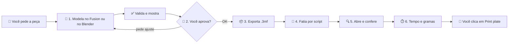

<div align="center">

# 🖨️ generate-bambu

**Peça uma peça. Seu agente modela no Fusion ou no Blender, valida, exporta o `.3mf` multicor, fatia e deixa pronto no Bambu Studio.**

*Uma skill para Claude, Codex, Gemini CLI e Antigravity que leva uma ideia da conversa até a mesa da impressora, com você aprovando cada passo importante.*

<br>


[](https://github.com/Grolla05/Generate-bambu/actions/workflows/ci.yml)


[Como funciona](#-como-funciona) •
[Demonstração](#-demonstração) •
[Instalação](#-instalação) •
[Como usar](#-como-usar) •
[Decisões de design](#-decisões-de-design) •
[Limitações](#-limitações)

</div>

---

## 💡 Sobre

Este projeto nasceu de um problema simples: **comprei uma impressora 3D sem saber modelar nos mínimos detalhes**. Eu tinha só uma noção básica, e o gargalo nunca foi a máquina, foi o conhecimento de modelagem.

A solução foi transformar o processo em uma **skill**: uma sequência fixa de seis passos que vai do pedido em linguagem natural até o projeto fatiado no Bambu Studio. O agente cuida da parte repetitiva e técnica. As decisões que importam continuam sendo suas: **você aprova a forma antes de exportar e confirma antes de imprimir**.

> [!NOTE]
> **Geometria construída** (placas, letreiros, chaveiros, ímãs, vasos, caixas, suportes, engrenagens, peças com rosca ou encaixe) vai para o Fusion. **Forma orgânica estilizada** (bichos e bonecos low-poly) vai para o Blender. Realismo fica fora do método (veja [Limitações](#-limitações)).

---

## ⚙️ Como funciona



| # | Passo | O que acontece |
|:-:|---|---|
| **1** | 🧩 **Modelar, validar e mostrar** | O agente cria um design **paramétrico** no Fusion, via script. Cada cor é um corpo separado (`slotN_descricao`). Roda uma validação automática e deixa a peça aberta no Fusion para você girar e inspecionar. |
| **2** | 👤 **Esperar o OK** | Parada obrigatória. Se pedir ajuste, o agente muda os parâmetros no **mesmo documento**, valida de novo e salva uma nova versão. |
| **3** | 📦 **Exportar o `.3mf`** | Só depois do OK. Um único `.3mf` com **um objeto por slot do AMS**, camada de 0,12 mm. Sem STL, sem ZIP, sem pasta de arquivos soltos. |
| **4** | 🔪 **Fatiar por script** | `scripts/fatiar.py` usa o CLI do Bambu Studio, sem clique e sem diálogo, e confere camada, filamentos e **dimensões**. Funciona em qualquer agente com terminal. |
| **5** | 🔍 **Abrir e conferir** | O fatiado abre no Bambu Studio já colorido, para você conferir. |
| **6** | ⏱️ **Pronto para imprimir** | Mostra o **tempo estimado** e os **gramas por filamento**. **A skill nunca imprime:** quem clica em *Print plate* é você. |

### ✅ O que a validação garante (passo 1)

- Todo corpo é sólido e tem o prefixo `slotN_`
- Alturas em **múltiplos da camada** (0,12 mm)
- Peça inteira dentro de **250 × 250 × 250 mm** (Bambu Lab A1)
- No máximo **4 slots** de cor (AMS Lite)
- **Nenhuma interferência** entre corpos e nenhuma cor padrão do Fusion
- Espessuras mínimas e balanços conferidos contra as regras de FDM da A1

---

## 🎬 Demonstração

> [!TIP]
> Substitua as imagens abaixo pelas suas capturas. Basta salvar os arquivos em `docs/images/` com os nomes indicados e o README passa a exibi-los.

### Do pedido à peça

<div align="center">


<sub><i>Fluxo completo, do pedido ao slice (GIF)</i></sub>

</div>

### Passo a passo

<table>
  <tr>
    <td align="center" width="50%">
      <br>
      <b>1. O pedido</b><br>
      <sub>Linguagem natural, sem precisar saber modelar</sub>
    </td>
    <td align="center" width="50%">
      <br>
      <b>2. Modelagem no Fusion</b><br>
      <sub>Design paramétrico, um corpo por cor</sub>
    </td>
  </tr>
  <tr>
    <td align="center" colspan="2">
      <br>
      <b>3. Bambu Studio</b><br>
      <sub>Cores por slot e dimensões conferidas</sub>
    </td>
  </tr>
</table>

### Resultado

<div align="center">


<sub><i>A peça final impressa na Bambu Lab A1 com AMS Lite</i></sub>

</div>

---

## 📋 Requisitos

| Requisito | Detalhe |
|---|---|
| 🤖 **Agente** | Claude, Codex, Gemini CLI ou Antigravity |
| 🧩 **Autodesk Fusion** | Para peça de medida exata. Instalado, com o **servidor MCP local** ativo em Preferences → General → API → Fusion MCP Server (*Apply* e depois *OK*) |
| 🐒 **Blender** | Opcional, para forma orgânica estilizada. 5.1 ou mais novo; roda por terminal, com MCP opcional |
| 🖨️ **Impressora** | Bambu Lab **A1** com **AMS Lite** (até 4 cores) |
| 🖥️ **Bambu Studio** | Instalado (testado na 02.08.03.66) |
| 🐍 **Python** | 3.10 ou mais novo, para fatiar pelo CLI. Sem ele, vale o [plano B por cliques](skills/generate-bambu/referencias/bambu-cliques.md) |
| 🪟 **Sistema** | Windows (os caminhos e o fluxo do Bambu Studio foram testados nele) |
| 🖱️ **Controle do computador** | Opcional, só para o plano B. Nunca clica em *Print plate* |

> [!IMPORTANT]
> O que muda entre agentes está em [`referencias/agentes.md`](skills/generate-bambu/referencias/agentes.md).

---

## 🚀 Instalação

Use **um canal só por agente**. Plugin e cópia da pasta juntos criam skills duplicadas.

### Claude

```bash
claude plugin marketplace add Grolla05/Generate-bambu
```

```bash
claude plugin install generate-bambu@grolla05-plugins
```

No app desktop, adicione `Grolla05/Generate-bambu` como marketplace pela tela de plugins. A chamada direta é `/generate-bambu:generate-bambu`.

O plugin não traz o MCP do Fusion: use a extensão Autodesk Fusion do app, ou rode `instalar.ps1 -McpClaude` para registrá-lo no Claude Code.

### Codex

```bash
codex plugin marketplace add Grolla05/Generate-bambu
```

```bash
codex plugin add generate-bambu@grolla05-plugins
```

No app, o mesmo marketplace aparece na tela de plugins. O plugin já traz o MCP do Fusion.

### Gemini CLI

```bash
gemini extensions install https://github.com/Grolla05/Generate-bambu
```

A extensão já traz o MCP do Fusion. O Gemini CLI parou de atender contas individuais em junho de 2026: sem chave de API ou conta enterprise, use o Antigravity.

### Antigravity

```bash
git clone https://github.com/Grolla05/Generate-bambu
```

```bash
agy plugin install ./Generate-bambu
```

O plugin já traz o MCP do Fusion.

### Instalador para Windows

Sem plugin, o `instalar.ps1` detecta os agentes, copia a skill para a pasta de cada um e grava a configuração do MCP. Ele pula o agente que já tem plugin ou extensão, mostra o plano e pede confirmação.

```bash
git clone https://github.com/Grolla05/Generate-bambu
```

```powershell
powershell -NoProfile -ExecutionPolicy Bypass -File .\Generate-bambu\instalar.ps1 -Simular
```

| Opção | O que faz |
|---|---|
| `-Simular` | Só mostra o plano |
| `-Agentes codex,antigravity` | Limita aos agentes citados: `claude`, `codex`, `gemini`, `antigravity`, `agy` |
| `-Sim` | Aplica sem perguntar |
| `-Desinstalar` | Remove só o que o script instalou |
| `-McpClaude` | Registra o MCP do Fusion no Claude Code |

> [!NOTE]
> O script faz backup de cada arquivo que altera (`.bak-<data>`), ao lado do original. Esses arquivos têm tokens: não os compartilhe. Arquivo com comentários ou JSON inválido fica intacto, e o script pede para adicionar o MCP à mão. Feche o app do Codex antes de rodar.

### ✔️ Conferindo a instalação

```bash
claude plugin details generate-bambu
```

```bash
codex plugin list
```

```bash
gemini extensions list
```

```bash
agy plugin list --json
```

### 🔄 Atualizando

Quem tem a versão 1.0.0 instalada recebe a nova estrutura pelos mesmos comandos.

```bash
claude plugin marketplace update grolla05-plugins
```

```bash
claude plugin update generate-bambu@grolla05-plugins
```

```bash
codex plugin marketplace upgrade grolla05-plugins
```

```bash
codex plugin add generate-bambu@grolla05-plugins
```

```bash
gemini extensions update generate-bambu
```

No Antigravity, atualize o clone e rode `agy plugin install` de novo. Com o instalador, atualize o clone e rode o script de novo.

---

## 🕹️ Como usar

Com a skill instalada e o Fusion aberto, basta pedir. Ela é acionada sozinha em qualquer pedido de criar, desenhar ou modelar uma peça para impressão 3D, em português ou inglês.

### Exemplos de pedidos

```text
Faz um chaveiro retangular de 60 x 30 mm com o nome "Felipe" em relevo,
base azul e letras brancas.
```

```text
Preciso de um porta-copo redondo de 90 mm com um brasão em relevo de duas cores.
```

```text
Modela um vaso de 80 mm de altura com parede de 2 mm, em uma cor só.
```

```text
Cria uma lembrancinha de 70 x 50 mm com a data "12/10" e uma moldura em dourado.
```

### O que esperar na conversa

1. O agente confirma o que vai modelar e quantas cores a peça tem.
2. A peça aparece **aberta no Fusion**, com as dimensões finais, a lista de slots (cor, altura, camadas) e os ajustes de camada que foram feitos.
3. Ele pergunta se está aprovado. Você pede ajustes quantas vezes quiser.
4. Com o OK, exporta, fatia e mostra **tempo e gramas**. Quem manda imprimir é você, no Bambu Studio.
5. Ele pergunta **"posso mandar imprimir?"** e espera a sua resposta.

---

## 🧠 Decisões de design

| Decisão | Por quê |
|---|---|
| 🧩 **Modelagem só pelo Fusion** | Nada de SVG, malha gerada em código ou OpenSCAD. A peça precisa ser editável de verdade: mudar uma medida é editar um parâmetro, não refazer o desenho. |
| 📐 **Alturas em múltiplos da camada** | O slicer não sabe fazer 0,8 mm numa camada de 0,12 mm. A skill arredonda (0,8 mm vira 0,84 mm) e **avisa cada ajuste**, para você aprovar a peça que realmente vai sair. |
| 🎨 **Um corpo por cor, um objeto por slot** | A cor vai pintada na malha do `.3mf`, e cada slot do AMS vira um objeto. O Bambu Studio já abre o projeto com as cores certas. |
| 🛑 **Duas paradas obrigatórias** | Aprovar a forma (passo 2) e autorizar a impressão (passo 6). Plástico e horas de máquina só são gastos com a sua confirmação. |
| 👁️ **Nada "de memória"** | Se o agente fala do que está na tela do Fusion ou do Bambu Studio, é porque capturou a tela e leu, ou porque você informou. Se não conseguiu, ele diz que não conseguiu. |
| 🔌 **Um repositório, vários agentes** | A skill mora em `skills/` e cada agente tem seu manifesto. Os testes conferem que nome, versão e URL do MCP são iguais em todos. |
| 🧭 **Capacidades, não ferramentas** | O `SKILL.md` descreve a ação; `referencias/agentes.md` traduz para a ferramenta de cada agente. |
| 📏 **Conferência de unidade** | As dimensões no Bambu Studio têm que bater com o Fusion. Uma peça 1000× maior ou menor indica erro de unidade, e a correção é refazer a exportação, nunca escalar no slicer. |
| ⚖️ **Design de terceiros fica de fora** | Personagens, marcas, carros e logos pertencem a outras pessoas. A skill oferece um desenho **original** no lugar. |

---

## 🗂️ Estrutura do repositório

```text
Generate-bambu/
├── .agents/plugins/
│   └── marketplace.json            # Codex: catálogo
├── .antigravity-plugin/
│   └── plugin.json                 # Antigravity: manifesto
├── .claude-plugin/
│   ├── marketplace.json            # Claude: catálogo
│   └── plugin.json                 # Claude: manifesto
├── .codex-plugin/
│   └── plugin.json                 # Codex: manifesto
├── skills/
│   └── generate-bambu/
│       ├── SKILL.md                # o fluxo de seis passos
│       ├── config.example.json     # modelo da configuração local
│       ├── agents/
│       │   └── openai.yaml         # Codex: dependência do MCP e invocação
│       ├── referencias/
│       │   ├── agentes.md          # capacidades, instalação e MCP por agente
│       │   ├── fusion-api.md       # receitas testadas de script, validação e exportação
│       │   ├── blender-api.md      # receitas testadas para forma orgânica
│       │   ├── bambu-cliques.md    # plano B por cliques
│       │   ├── fdm-a1.md           # espessuras, folgas, orientação e balanços da A1
│       │   └── limites.md          # triagem do que cabe (ou não) no método
│       ├── helpers/
│       │   ├── agrupar_3mf.py      # agrupa o 3MF em um objeto por slot
│       │   └── blender_3mf.py      # roda no Blender: valida e exporta
│       └── scripts/
│           ├── config.py           # configuração local e access code
│           ├── diagnostico.py      # o que está pronto nesta máquina
│           ├── detectar_modeladores.py  # qual modelador usar
│           ├── fatiar.py           # fatia pelo CLI do Bambu Studio
│           ├── projeto_bambu.py    # monta o projeto nativo
│           ├── perfis.py           # resolve os perfis instalados
│           ├── bambu_3mf.py        # lê tempo e gramas do fatiado
│           └── status.py           # estado da impressora, só leitura
├── .github/
│   └── workflows/
│       └── ci.yml                  # CI: lint, validação da skill, testes e instalador
├── tests/                          # testes do helper, da documentação, dos manifestos e do instalador
├── docs/
│   └── images/                     # capturas de tela e GIFs da demonstração
├── gemini-extension.json           # Gemini CLI: manifesto
├── instalar.ps1                    # instalador para Windows
├── mcp.json                        # MCP do Fusion para Codex e Antigravity
├── pyproject.toml                  # configuração do pytest e do ruff
├── requirements-dev.txt            # pytest e ruff
├── LICENSE
└── README.md
```

---

## ⚙️ Configuração

A configuração fica em `~/.generate-bambu/config.json`, fora da skill, porque atualizar o plugin troca a pasta dela. O modelo é [`config.example.json`](skills/generate-bambu/config.example.json):

```bash
python skills/generate-bambu/scripts/config.py definir pasta_saida "D:/Impressao3D"
```

O access code da impressora só é necessário para `status.py`. Rode `config.py codigo` você mesmo, no terminal, para ele não passar pela conversa.

| O quê | Padrão | Observação |
|---|---|---|
| Pasta de saída dos `.3mf` | perguntada no primeiro uso | Chave `pasta_saida` |
| Perfis do Bambu Studio | A1, `0.12mm Fine`, PLA Basic | Seção `bambu_studio` |
| Modelador | escolhido peça a peça | `modelador.preferido` desempata |
| Projeto no Fusion | `generate-bambu` | Chave `fusion.projeto`; criado automaticamente se não existir |
| Impressora | A1 | `config.py maquina "A1 mini"` ou `"P1S"` grava limites e perfis juntos; essas duas foram conferidas só até o fatiamento |
| Altura de camada | `0,12 mm` | Parâmetro `camada` no início do design |
| Perfil | sem perfil | `~/.generate-bambu/perfil.md`, com o seu contexto. Modelo em [`perfil.example.md`](skills/generate-bambu/perfil.example.md) |

---

## ⚠️ Limitações

- **Só geometria construída.** O Fusion faz booleana, fillet, chamfer, shell, rosca e texto. Rosto, corpo e animal realista não cabem no método.
- **Até 4 cores**, pelos 4 slots do AMS Lite. Acima de 2 cores, o custo de purga de filamento sobe.
- **Volume de 250 × 250 × 250 mm**, o limite da Bambu Lab A1.
- **O perfil de impressão não vem no `.3mf`.** A altura de camada de 0,12 mm é ajustada no Bambu Studio a cada projeto.
- **Controle de tela é opcional e frágil.** Só entra como plano B, se o fatiamento por script falhar. Se um clique não faz efeito, a skill para e pergunta, em vez de repetir às cegas. Ele nunca clica em *Print plate*.
- **Peça multicor que ocupa quase a mesa inteira nos dois lados é recusada:** falta lugar para a torre de purga.
- **Licença do Fusion.** Com a licença *Education* (uso não comercial), as peças servem para uso próprio e presentes. Para **vender** o que for impresso, revise a licença do Fusion antes.

---

## 🧪 Testes e CI

A cada push e pull request, o GitHub Actions ([`ci.yml`](.github/workflows/ci.yml)) roda:

| Job | O que valida |
|---|---|
| **Lint** | `ruff check` em todo o código Python e `agentskills validate` na skill |
| **Testes** | `compileall` e `pytest` em Python **3.10, 3.11, 3.12 e 3.13** |
| **Instalador** | `instalar.ps1` no PowerShell 5.1 do Windows, contra uma pasta de usuário falsa |

Os testes cobrem o `agrupar_3mf.py` com 3MFs sintéticos (agrupamento por slot, volumes, malhas fechadas, cores, transformações e as recusas de entrada inválida), a sintaxe dos trechos Python da documentação, a consistência dos manifestos de cada agente e o instalador.

Para rodar localmente:

```bash
pip install -r requirements-dev.txt
ruff check .
pytest
```

---

## 🛣️ Roadmap

- [ ] Placa de calibração para medir a folga real de processo da máquina
- [x] Suporte a outras impressoras da linha Bambu Lab (A1 mini e P1S, conferidas só até o fatiamento)
- [x] Perfil de impressão salvo junto com o projeto
- [ ] Conferir a exportação por script com o Fusion real
- [ ] Biblioteca de peças-base (chaveiro, porta-copo, placa) como pontos de partida
- [ ] Avaliações que comparam como cada agente respeita as paradas obrigatórias
- [ ] Versão em inglês da documentação

---

## 🤝 Contribuindo

Ideias, correções e novos tipos de peça são bem-vindos. Abra uma *issue* descrevendo o caso ou envie um *pull request*.

## 📄 Licença

Distribuído sob a licença MIT. Veja o arquivo [`LICENSE`](LICENSE).

## 👤 Autor

**Felipe Grolla**, estudante de Engenharia de Controle e Automação na PUC-Campinas.

[](https://github.com/Grolla05)
[](https://www.linkedin.com/in/felipegrolla)

<div align="center">

<sub>Feito com 🧩 Fusion, 🖨️ Bambu Lab e 🤖 Claude</sub>

</div>
